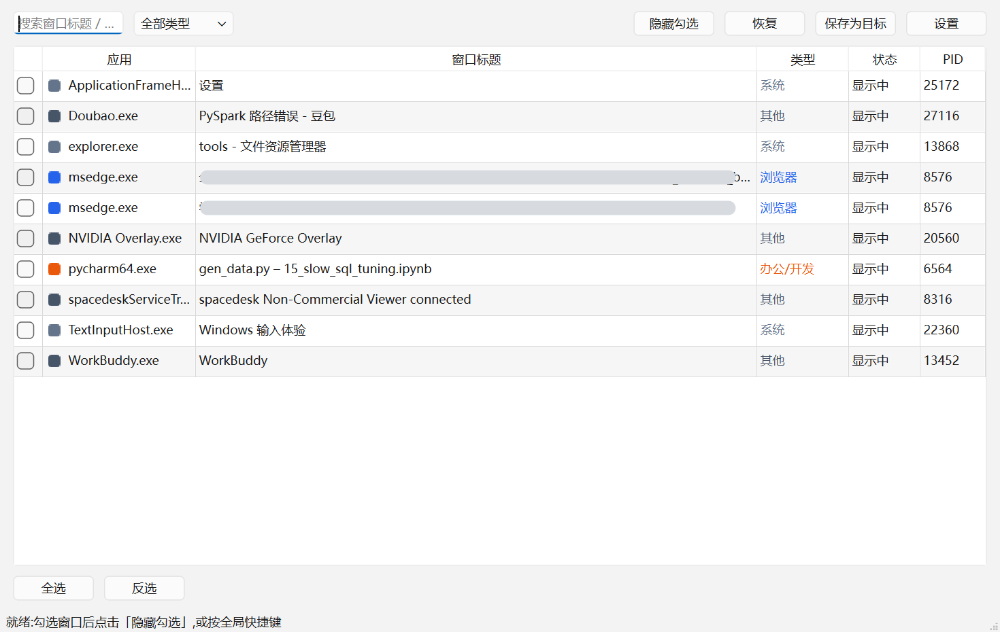

<div align="center">


# WindowHide

**A "boss key" for Windows: tick a few windows, hit one hotkey, and they vanish
from the taskbar, Alt+Tab and the system tray.**

The programs keep running — downloads, playback, renders, nothing is interrupted.
Bring them back with the same hotkey, or a click on the tray icon.
No DLL injection, no global hooks, no synthetic input: only documented Win32 APIs.

[](#requirements)
[](#quick-start)
[](LICENSE)

[Download](../../releases) · [中文说明](README.md)

</div>



## Features

- **Hide properly, not minimize** — the window disappears from the taskbar button
  area *and* from Alt+Tab (`SW_HIDE` + `WS_EX_TOOLWINDOW`), and the program's tray
  icon is removed too (`Shell_NotifyIcon(NIM_DELETE)`).
- **Profiles** — bundle a set of rules into a named scene ("Work" / "Game") and
  switch with one click from the tray menu. Switching hides the windows of the new
  profile and releases the ones hidden by *other* profiles; windows you hid
  manually are never touched.
- **Never hides critical processes** — `dwm.exe`, the IME host
  (`TextInputHost.exe`), the UWP frame host and friends are protected by default
  (you can add your own). Hiding them would break your desktop or your keyboard.
- **Won't hang your desktop** — every cross-process window call runs on a worker
  thread, and windows owned by an unresponsive process are never touched
  (`IsHungAppWindow`). A stuck target can no longer freeze the UI.
- **Mute on hide** — mutes the target program through the system volume mixer,
  including its child processes (browsers play audio in a child process).
- **Honest about failures** — if a window cannot be hidden (elevated process,
  exclusive-fullscreen game), you get a tray notification instead of silent
  "success". Nothing is left in a half-minimized, unreachable state.
- **Remembers state** — hidden windows survive a restart of the tool: they are
  never orphaned in "invisible with no way back".

## Requirements

- Windows 10 / 11 (64-bit)
- Python 3.10+ with `PySide6>=6.5` (see `requirements.txt`)
- If the target runs **as administrator**, WindowHide must run elevated too —
  otherwise UIPI silently blocks every window operation. There is a
  "Restart as administrator" item in the tray menu.

## Quick start

```bat
python -m venv .venv
.venv\Scripts\pip install -r requirements.txt
run.bat
```

`run.bat` looks for an interpreter in this order: local `.venv` → `pythonw.exe` on
`PATH` → `pyw -3`, and **verifies that the candidate can actually
`import PySide6`** — `pythonw` fails silently otherwise.

Then:

1. Tick the windows you want to manage in the list (search / type filter available)
2. Press "隐藏勾选" (Hide selected) — they move to the background
3. Press the global hotkey (default `Ctrl+Alt+H`) or single-click the tray icon to
   bring them back

## Configuration

`%APPDATA%\WindowHide\config.json`, format version **2**:

```jsonc
{
  "version": 2,
  "active_profile": "Work",
  "profiles": [
    {"name": "Work", "mute": true,
     "rules": [{"process": "Steam.exe", "window_class": "", "title_regex": "", "label": "Steam"}]},
    {"name": "Game", "mute": false, "rules": []}
  ],
  "protected_processes": ["SomeMonitoringAgent.exe"]
}
```

A v1 config (flat `targets`) is upgraded automatically on start, and the original
file is kept as `config.v1.bak.json`.

## Known limits

- **Exclusive-fullscreen games** cannot be hidden by a non-injecting tool: the game
  keeps presenting frames via DXGI regardless of `WS_VISIBLE`. The default is to
  report "could not hide" instead of minimizing (minimizing can leave some engines
  in a state they never recover from). Setting the game to *borderless windowed*
  makes everything work.
- Tray icons registered by GUID (some Electron apps) cannot be removed from outside
  the process; the window itself is still hidden.
- Windows owned by an unresponsive process are skipped on purpose.

## Development

```bash
.venv\Scripts\python tests\logic_test.py     # pure logic, runs in CI
.venv\Scripts\python tests\profile_test.py   # profiles / protection / auto-apply
```

Most other tests need a real interactive desktop session and are therefore not part
of CI. Design notes (why the taskbar entry disappears, why fullscreen games are
special, how UIPI bit us, …) are in [docs/DESIGN.md](docs/DESIGN.md) (Chinese).

## License

[MIT](LICENSE)
