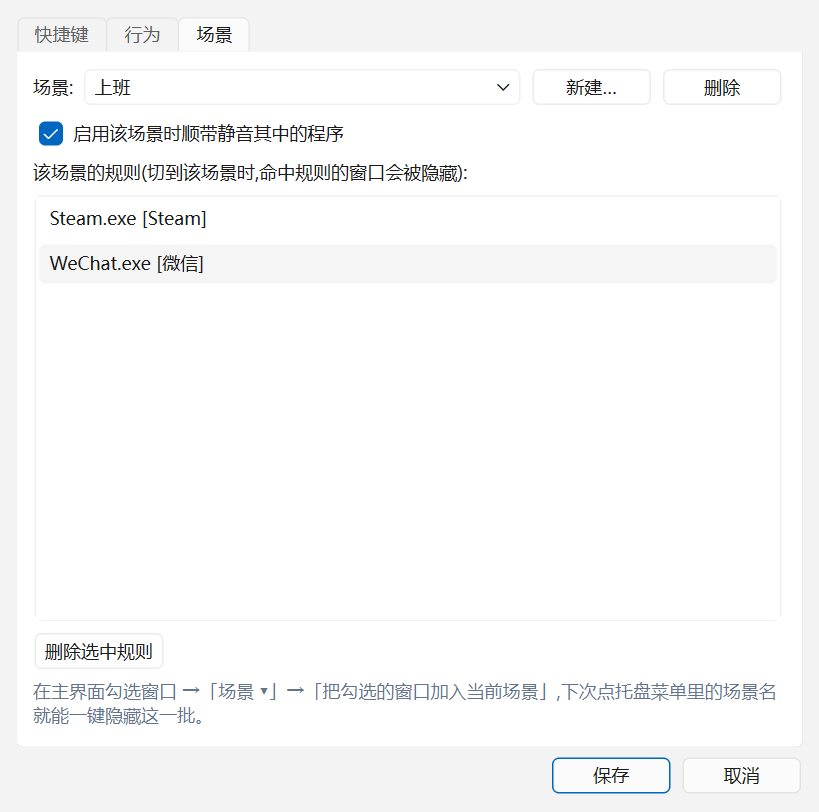
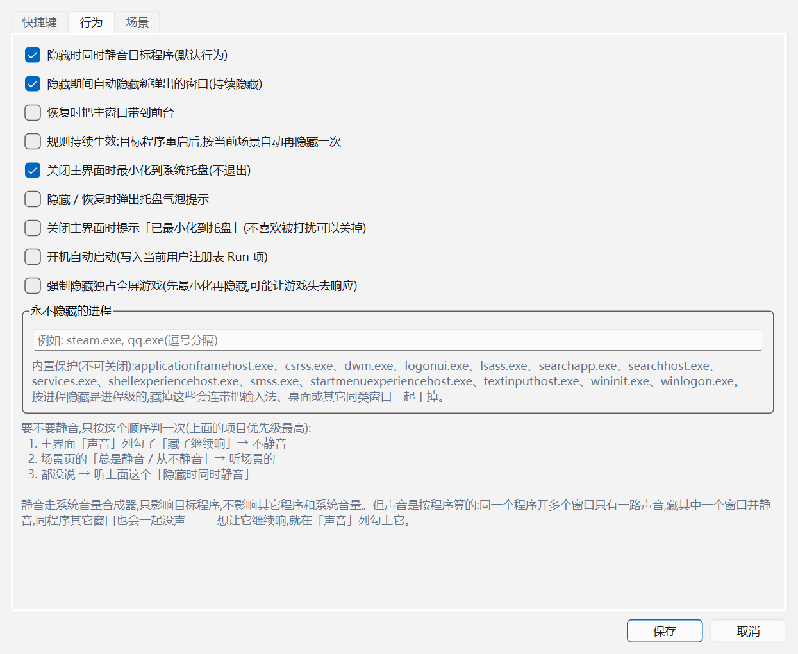

<div align="center">


# WindowHide · 窗口隐藏工具

**Windows 上的「老板键」:勾几个窗口,一键从任务栏、Alt+Tab、托盘里消失。**

程序照常运行,下载、播放、直播都不受影响;需要时一个快捷键就回来。
不注入 DLL、不挂钩子、不模拟键鼠 —— 只调用微软公开的 Win32 API。

[](#运行环境)
[](#快速开始)
[](LICENSE)
[](https://github.com/carefreegui/WindowHide/actions/workflows/tests.yml)

[快速开始](#快速开始) · [功能](#功能) · [场景](#场景推荐用法) · [配置](#配置文件) · [常见问题](#常见问题) · [设计笔记](docs/DESIGN.md) · [English](README.en.md) · [Releases](../../releases)

</div>


> 隐藏 = **后台化**,不是关闭。

<details>
<summary>另外两张截图:场景设置 / 行为设置</summary>





</details>

## 功能

- **按多种方式选目标**
  - 窗口标题 / 进程名实时列表,支持搜索
  - 应用类型分组:浏览器 / 即时通讯 / 游戏 / 媒体播放 / 办公开发 / 系统 / 其他
  - 勾选后可「加入当前场景」,重启自动重新识别(按 进程名+窗口类名 匹配)
  - **场景**:把一批规则打包命名(上班 / 摸鱼 / 游戏),托盘菜单里一键切换 ——
    切到某场景时自动藏它命中的窗口,并放掉**别的场景**藏的窗口(手动藏的不动)
  - **永不隐藏名单**:`dwm.exe`、输入法 `TextInputHost.exe`、UWP 宿主等系统
    关键进程内置保护(可加自定义);列表里标「受保护」,拒绝隐藏并说明原因
  - 「未响应」的窗口标题显示为 `(无响应)`,不会被误当成普通窗口去操作
- **彻底隐藏**
  - 窗口从任务栏按钮和 Alt+Tab 列表消失(`SW_HIDE` + `WS_EX_TOOLWINDOW`)
  - 全屏窗口/游戏默认只做安全隐藏;藏不掉会如实报告,不去动它的最小化状态
  - 可选「强制隐藏独占全屏游戏」(先最小化逼出全屏再隐藏,**有让游戏失去响应的风险**,默认关闭)
  - 目标程序已经"未响应"时**完全不动它**,并说明原因(动它会把本工具一起卡死)
  - 隐藏/恢复全部在工作线程执行,界面永不因为目标卡住而冻住
  - 目标程序的托盘图标也会被移除(`Shell_NotifyIcon(NIM_DELETE)`)
  - 隐藏期间自动压制新弹出的窗口(可关)
  - 可选「规则持续生效」:目标程序重启后,按当前场景自动再藏一次
    (手动点过恢复的窗口不会被它抢回去)
  - 藏不掉的窗口会明确报出来(托盘气泡 + 状态栏 + 日志),不静默假装成功
- **快速恢复**
  - 全局快捷键两种模式:单一快捷键反复切换(隐藏 ⇄ 恢复),或「隐藏键 / 恢复键」分离
  - 点击系统托盘图标即切换隐藏/恢复;托盘菜单可显示主界面、以管理员身份重启或退出
- **工具自藏**
  - 「隐藏本工具」快捷键/托盘菜单:把主窗口收进托盘(与点叉号等效),双击托盘图标唤回
- **可选辅助控制**
  - 隐藏时同时静音目标程序(调用系统音量合成器接口,含子孙进程,恢复时自动取消)
- **不打扰**
  - 只改窗口显示状态,不向目标程序发送任何按键/鼠标事件
  - 关闭主界面默认最小化到托盘,不退出;那条「已最小化到托盘」的提示
    可以单独关掉(设置 → 行为),不想看到任何气泡就两个开关都关
  - 退出时会自动恢复所有被隐藏的窗口

## 快速开始

### 方式一:直接用 exe(不用装 Python)

到 [Releases](../../releases) 下 `WindowHide.exe`(或直接用 `dist/WindowHide.exe`)双击就行 —— 单文件,不依赖
Python / PySide6。首次启动约 2 秒(单文件要先解包到 `%TEMP%`)。

自己打一个:

```bat
.venv\Scripts\pip install pyinstaller
.venv\Scripts\python tools\build_exe.py
:: 产物:dist\WindowHide.exe(约 46 MB)
```

> 首次运行 Windows 可能弹「已保护你的电脑」(SmartScreen)—— 这是所有
> 没有代码签名的个人开发 exe 的通病,点「更多信息 → 仍要运行」。
> 个别杀软会误报 PyInstaller 打包的程序,加信任即可。

### 方式二:源码运行

```bash
# 1. 建虚拟环境并装依赖(推荐,run.bat 会优先用它)
python -m venv .venv
.venv\Scripts\pip install -r requirements.txt

# 国内网络慢的话换镜像
.venv\Scripts\pip install -i https://mirrors.aliyun.com/pypi/simple/ PySide6

# 2. 启动(无控制台窗口)
run.bat
# 或者
.venv\Scripts\python run.pyw
```

`run.bat` 会依次找:项目内 `.venv` → PATH 里的 `pythonw.exe` → `pyw -3`,
并且**要求候选解释器真的能 `import PySide6`**（否则 pythonw 会静默失败,
连个错都不给)。

启动后:

1. 在主界面列表里**勾选**要管理的窗口(可用搜索框/类型筛选快速定位)
2. 点「隐藏勾选」→ 勾选窗口全部后台化,列表状态变为"已隐藏"
3. 按全局快捷键(默认 `Ctrl+Alt+H` 切换)或**单击托盘图标**恢复

想一键切换一整批窗口(上班 / 摸鱼 / 游戏)?看下面的 [场景](#场景推荐用法)。

## 场景(推荐用法)

一个场景 = 一批规则 + 要不要顺带静音。三步就能建好:

1. 打开要藏的程序,在主界面**勾选**它的窗口
2. 点「**场景 ▾**」→「新建场景…」,起个名字(上班 / 摸鱼 / 游戏)
3. 以后在**托盘菜单 →「场景」** 里点一下,就切过去了(主界面也能切)

切换的时候三件事同时发生,规则是写死的,没有隐藏开关:

| | 行为 |
| --- | --- |
| **藏** | 该场景规则命中的窗口 |
| **放** | **别的场景**之前藏起来的窗口(换场合就该换一批) |
| **不动** | 你**手动勾选**藏的窗口 —— 那是你自己的临时决定,场景不该覆盖它 |

场景可以带「顺带静音」:勾上后切到它时,把其中的程序一起静音,恢复时自动取消。

设置里的 **规则持续生效**(默认关闭):打开后,目标程序关掉再重新打开,
几秒内会被自动再藏一次。但你手动点过「恢复」的窗口不会被它抢回去。

## 运行环境

- Windows 10 / 11(64 位)
- Python 3.10+,依赖:`PySide6>=6.5`(见 `requirements.txt`)
- **目标程序以管理员权限运行时,本工具也必须以管理员身份运行**(否则 UIPI
  会拦掉所有窗口操作)。托盘菜单里有「以管理员身份重启」一键切换。
## 配置文件

`%APPDATA%\WindowHide\config.json`,格式版本 **v2**:

```jsonc
{
  "version": 2,
  "active_profile": "上班",
  "profiles": [
    {"name": "上班", "mute": true,
     "rules": [{"process": "Steam.exe", "window_class": "", "title_regex": "", "label": "Steam"}]},
    {"name": "游戏", "mute": false, "rules": []}
  ],
  "protected_processes": ["某监控客户端.exe"]   // 永不隐藏的自定义补充
}
```

v1(平铺 `targets`)的旧配置启动时**自动升级**,原文件备份成
`config.v1.bak.json` —— 升级失败也不会把你手写的配置弄丢。
## 急救:窗口卡在"最小化、点不回来"

`tools/rescue_window.bat` 双击即可(会自己弹 UAC 提权),自动找到
游戏进程 → `SetWindowPlacement` 拉回 → `SC_RESTORE` → 抢前台 → 取消静音。
适用于本工具(或任何同类工具)把全屏游戏最小化后没恢复的场景。
## 开发

### 目录结构

```
windowhide/
├── run.pyw / run.bat         # 入口(run.bat 自动探测带 PySide6 的解释器)
├── requirements.txt
├── LICENSE                   # MIT
├── docs/                     # 界面截图 + 路线图 + 需要真人配合的测试清单
├── .github/workflows/        # CI:纯逻辑测试(需真实桌面的不进去)
├── windowhide/
│   ├── app.py                # 引导:QLocale 修复 / 单实例 / 装配
│   ├── config.py             # JSON 配置 v2(%APPDATA%\WindowHide\config.json,含场景)
│   ├── core/                 # 与界面无关的核心能力
│   │   ├── win32.py          #   ctypes Win32 封装(枚举/样式/显隐)
│   │   ├── classify.py       #   应用类型分类
│   │   ├── targets.py        #   目标规则与匹配
│   │   ├── protect.py        #   永不隐藏名单(系统/输入关键进程)
│   │   ├── hide.py           #   隐藏/恢复控制器(含持续隐藏看门狗)
│   │   ├── trayhide.py       #   托盘图标跨进程移除/恢复
│   │   ├── hotkeys.py        #   全局热键(RegisterHotKey 线程)
│   │   └── audio.py          #   按进程树静音(Core Audio,含子孙进程)
│   └── ui/                   # PySide6 界面
│       ├── main_window.py    #   主窗口
│       ├── window_list.py    #   窗口表格
│       ├── settings_dialog.py#   设置(快捷键/行为/场景)
│       ├── hotkey_edit.py    #   快捷键捕获按钮
│       ├── tray.py           #   系统托盘
│       └── icon.py           #   程序绘制图标(无外部资源)
└── tests/
    ├── logic_test.py         # 纯逻辑单元测试(分类/匹配/配置/热键文案,可进 CI)
    ├── smoke_test.py         # 冒烟测试(枚举/分类/配置/托盘通路)
    ├── integration_test.py   # 真实窗口隐藏恢复 + 托盘移除恢复 + 热键模拟
    ├── audio_test.py         # 静音功能测试(播音探针 + 静音/取消/状态查询)
    ├── audio_tree_test.py    # 进程树静音(父进程无会话、子进程播音,模拟浏览器)
    ├── tray_click_test.py    # 托盘点击切换链路(进程内真实 MainWindow)
    ├── checkbox_test.py      # 勾选行为回归(跨刷新保留/双击不误隐藏)
    ├── hang_test.py          # 无响应窗口不阻塞测试(挂起探针)
    ├── hung_test.py          # 无响应目标:不阻塞、不碰它、如实提示
    ├── hotkey_rereg_test.py  # 热键重复注册回归(曾静默死亡,现有回归测试)
    ├── hide_state_test.py    # 隐藏状态持久化回归(重启/多实例不丢)
    ├── foreground_test.py    # 前台窗口隐藏 core 回归(桌面/自藏保护)
    ├── fullscreen_test.py    # 全屏窗口回归(判定/先最小化再隐藏/失败上报)
    ├── profile_test.py       # 场景切换/保护名单/规则持续生效(临时 APPDATA)
    ├── gui_e2e.py            # GUI 端到端(启动真实程序,按键验证隐藏恢复)
    ├── dummy_app.py          # 测试专用假目标窗口(含 --fullscreen 全屏模式)
    ├── hang_probe.py         # 无响应窗口探针(测试辅助)
    ├── tray_probe.py         # 托盘图标探针(测试辅助)
    ├── audio_probe.py        # 播音探针(测试辅助)
    └── screenshot.py         # 纯 ctypes 截屏(全屏/PrintWindow 窗口)
└── tools/
    ├── rescue_window.bat     # 急救:把卡在最小化的游戏窗口拉回来(自动提权)
    └── rescue_window.py      #   同上,纯 Python 实现
```

### 测试

分两类。**需要真实 Windows 桌面会话的**(隐藏/恢复/静音/热键注入/全屏)在
CI 里跑不了 —— headless runner 没有交互式桌面,硬塞进去只会常年红灯 ——
所以 CI 只跑纯逻辑那部分,其余请在本机手动跑。

```bash
# 纯逻辑(无窗口、无桌面,CI 会跑):分类/匹配/配置/热键文案
python tests/logic_test.py

# 以下都需要真实桌面
python tests/smoke_test.py        # 冒烟:枚举/分类/配置/托盘通路
python tests/integration_test.py  # 集成:测试窗口隐藏恢复 + 托盘移除恢复 + 热键
python tests/audio_test.py        # 静音:播音探针静音/取消/状态查询
python tests/audio_tree_test.py   # 进程树静音:父进程无会话、子进程播音(模拟浏览器)
python tests/tray_click_test.py   # 托盘点击切换链路(进程内真实界面)
python tests/checkbox_test.py     # 勾选行为:跨刷新保留 + 双击不误隐藏 + 全选切换
python tests/hang_test.py         # 无响应窗口不阻塞(挂起探针)
python tests/hung_test.py         # 无响应目标:调用立即返回、不碰它、如实提示
python tests/hotkey_rereg_test.py # 热键重复注册:5 连改不静默死亡
python tests/hide_state_test.py   # 隐藏状态持久化:重启/多实例/过期清理
python tests/foreground_test.py   # 前台窗口隐藏 core:桌面/任务栏/自身保护
python tests/fullscreen_test.py   # 全屏窗口:判定/先最小化再隐藏/恢复/失败上报/权限预检
python tests/profile_test.py      # 场景切换/保护名单/规则持续生效/状态落盘(临时 APPDATA)
python tests/gui_e2e.py           # GUI 端到端:启动真实程序,自动探测空闲热键按键验证
```

实测结果(Win11,Python 3.13 + PySide6 6.12,15 个测试全绿):

| 测试 | 结果 |
| --- | --- |
| 纯逻辑(分类/匹配/配置往返/v1→v2 迁移+备份/场景/保护名单/日志轮转/热键文案) | 70/70 通过 |
| 冒烟(枚举/分类/配置/托盘通路自检) | 全部通过 |
| 集成(隐藏/恢复/样式还原/托盘删除与重注册/热键链路) | 12/12 通过 |
| 静音(静音→取消→状态查询,连跑 3 次稳定) | 全部通过 |
| 进程树静音(父无会话/子播音,浏览器架构) | 全部通过 |
| 托盘点击切换(曾因漏导入失效,现有回归测试) | 全部通过 |
| 勾选行为(跨刷新保留/双击不误隐藏/全选切换/消失清理) | 全部通过 |
| 无响应窗口不阻塞 | 全部通过 |
| 无响应目标(调用立即返回/完全不碰它/hung 提示/慢窗口缓存/对照组仍能隐藏) | 14/14 通过 |
| 热键重复注册(5 连改设置) | 全部通过 |
| 隐藏状态持久化(重启/多实例/死进程清理) | 全部通过 |
| 前台窗口隐藏 core(桌面/任务栏/自身保护/定向恢复) | 12/12 通过 |
| 全屏窗口(判定/默认不最小化/强制策略/恢复/失败上报/权限预检/回滚) | 26/26 通过 |
| 场景(切换藏/放/手动藏不被动/静音/保护名单/规则持续生效/状态落盘) | 20/20 通过 |
| GUI 端到端(热键 Ctrl+Alt+F8 切换隐藏/恢复) | 通过 |

集成测试会真实操作桌面(自动启动/关闭测试窗口与探针),结束时会恢复原状,
不影响正在使用的程序。热键一节分两步验证:先向热键消息窗口 post 一条
**伪造的 WM_HOTKEY** 确定性地走通"消息循环→wndproc→信号→主线程"链路;
再尝试 keybd_event 真实注入 —— 部分环境(如沙箱)会整体拦截合成输入,
此时用临时装的 **LL 键盘钩子**做 OS 层旁证:钩子没看到注入事件则记 SKIP
(环境限制,非代码回归),看到了却没触发才判 FAIL。

静音测试的两个环境坑(都已处理,非代码问题):① 探针先写 pid 再播音,
音频会话异步创建,紧接着查会拿到"0 个会话" —— 先轮询等会话出现;
② Windows 音量合成器**按应用记住静音状态**,上次测试若取消静音失败,
会给 python.exe 留下静音、新探针生来就是静音的 —— 测试先复位。
产品侧对应加固:恢复时取消静音带重试(会话可能被系统临时回收),
否则用户恢复窗口后应用会一直静着。

### 打包 exe

```bat
.venv\Scripts\pip install pyinstaller
.venv\Scripts\python tools\build_exe.py --clean
.venv\Scripts\python tests\exe_smoke_test.py   # 验收打包产物
```

几个刻意的选择:

- **onefile + windowed**:传给别人只有一个文件,而且不弹黑框。代价是启动要
  先解包(约 2 秒)。
- **manifest 用 `asInvoker`**:故意不默认要求管理员 —— 否则"藏个普通程序"
  每次都弹 UAC;要管管理员程序时走托盘里的「以管理员身份重启」。
- **图标资源**:`--add-data` 把 `windowhide/assets` 打进包里,运行时按
  `sys._MEIPASS` 找(`ui/icon.py` 的 `asset_dir()`)。
- **体积裁剪**:排除掉用不到的 Qt 模块(QtWebEngine/QtQuick/Qt3D…),
  150MB+ 压到 46MB。改排除表之后**必须真跑一次 exe** —— 有些模块是被
  Qt 插件反向依赖的,排掉后启动就崩,而打包过程不会有任何提示。

`tests/exe_smoke_test.py` 是打包产物的验收:启动耗时、进程名、图标、
热键注册、真实隐藏/恢复一个窗口。

### 更多

技术细节(为什么任务栏会消失、全屏游戏为什么藏不掉、无响应目标怎么防卡死、
UIPI 权限、托盘图标怎么删)都在 **[docs/DESIGN.md](docs/DESIGN.md)**。
想自己发版/发新版本:**[docs/GITHUB.md](docs/GITHUB.md)**(建仓库、push、tag、
Release、CI 是什么,都写了)。
优化路线见 [docs/ROADMAP.md](docs/ROADMAP.md),需要真人配合的测试清单见
[docs/MANUAL_TESTS.md](docs/MANUAL_TESTS.md)。

## 常见问题

- **隐藏没反应/部分窗口失败?** 工具会弹气泡告诉你是哪几个窗口没藏掉。
  最常见的原因是以管理员身份启动的程序(UIPI 会挡住对它的窗口操作),
  请用托盘菜单的「以管理员身份重启」。**权限不够时本工具不会动手** ——
  因为"最小化成功但隐藏失败"会把全屏游戏丢在点不回来的状态里。
- **全屏游戏还是藏不掉?** 默认只做安全隐藏(不动最小化状态),独占全屏的
  游戏会因为画面还留在屏幕上而报"没藏掉"。想强行藏可以到 设置 → 行为 勾
  「强制隐藏独占全屏游戏」——**注意**:部分游戏(实测永劫无间)被最小化后
  主线程就不再处理消息,游戏自己回不来,只能结束进程重开。默认关着就是
  为了避免这个。
- **目标程序"未响应"了能藏吗?** 不能,而且**不会去试**。对未响应的窗口做
  窗口操作会把本工具一起拖死,所以只弹提示让你先处理那个程序。
- **窗口卡在最小化、任务栏也找不到?** 先双击 `tools/rescue_window.bat`
  (会弹 UAC 提权);若脚本提示 `hung=True`,说明目标主线程已经不理消息,
  外部手段进不去 —— 只能任务管理器结束那个进程重开。
- **每次关窗口都弹一下「已最小化到托盘」,烦?** 设置 →「行为」→ 取消
  「关闭主界面时提示「已最小化到托盘」」。想彻底安静,再把上面那条
  「隐藏 / 恢复时弹出托盘气泡提示」也取消。
- **exe 被杀软拦了 / 提示未知发布者?** PyInstaller 打包的个人程序没有代码
  签名,SmartScreen 和部分杀软会拦。点「更多信息 → 仍要运行」,或把 exe 加进
  信任列表。也可以用源码跑(`run.bat`),功能完全一样。
- **快捷键没反应?** 组合键可能被其它软件占用,在设置里换一个组合。
- **恢复后托盘图标没回来?** 少数程序不处理 `TaskbarCreated` 消息,手动重启
  该程序即可,不影响窗口隐藏/恢复本身。
- **想开机自启?** 设置 → 行为 → 勾选"开机自动启动"(写当前用户注册表 Run 项,
  不需要管理员)。
## 开发状态与参与

- 优化路线(含实测数据与验收标准):[`docs/ROADMAP.md`](docs/ROADMAP.md)
- 需要真人配合的测试清单(游戏全屏、管理员权限、多显示器、长时间挂机):
  [`docs/MANUAL_TESTS.md`](docs/MANUAL_TESTS.md)

欢迎按测试清单里的步骤回报结果。**报问题时请附** `%APPDATA%\WindowHide\windowhide.log`
的最后几十行 + 程序名 + 工具当时是否以管理员身份运行 —— 这三样基本就能定位。
## 边界与免责

这是一个**本机窗口管理工具**,只做三件事:改目标窗口的显示状态、按进程移除
托盘图标、调系统音量合成器的静音开关。它**不注入 DLL、不挂钩子、不模拟
键盘鼠标**去操控目标程序,也不碰任何网络。

- 因为不注入,它对"独占全屏游戏""管理员权限程序"这类目标只能尽力而为,
  做不到的会在气泡里如实说,不会假装成功。
- 请只在**自己有权操作的设备**上使用。拿它偷窥、规避监护或规避审计不在
  支持范围内,也不被作者认可。
- 隐藏不等于隐身:目标程序仍在运行,任务管理器、资源监视器照样看得见。
## 许可证

[MIT](LICENSE)
